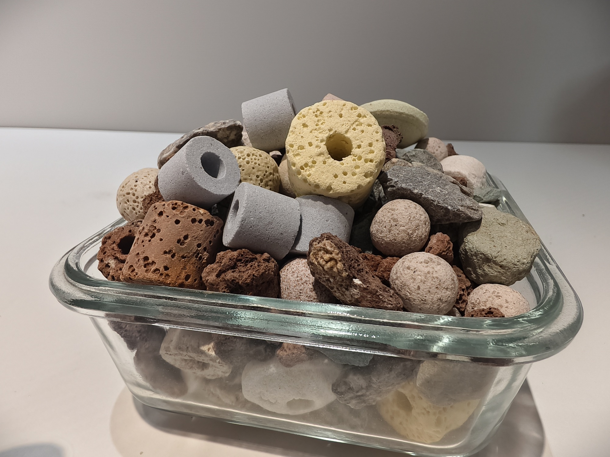
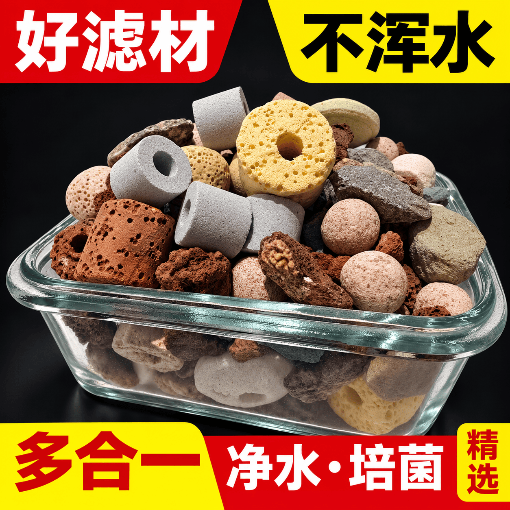
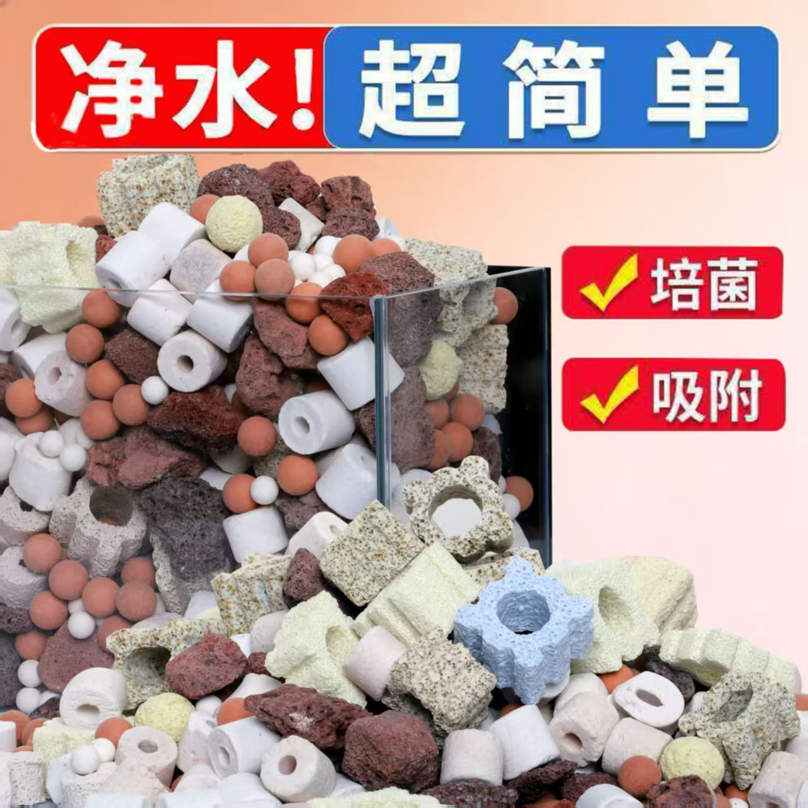
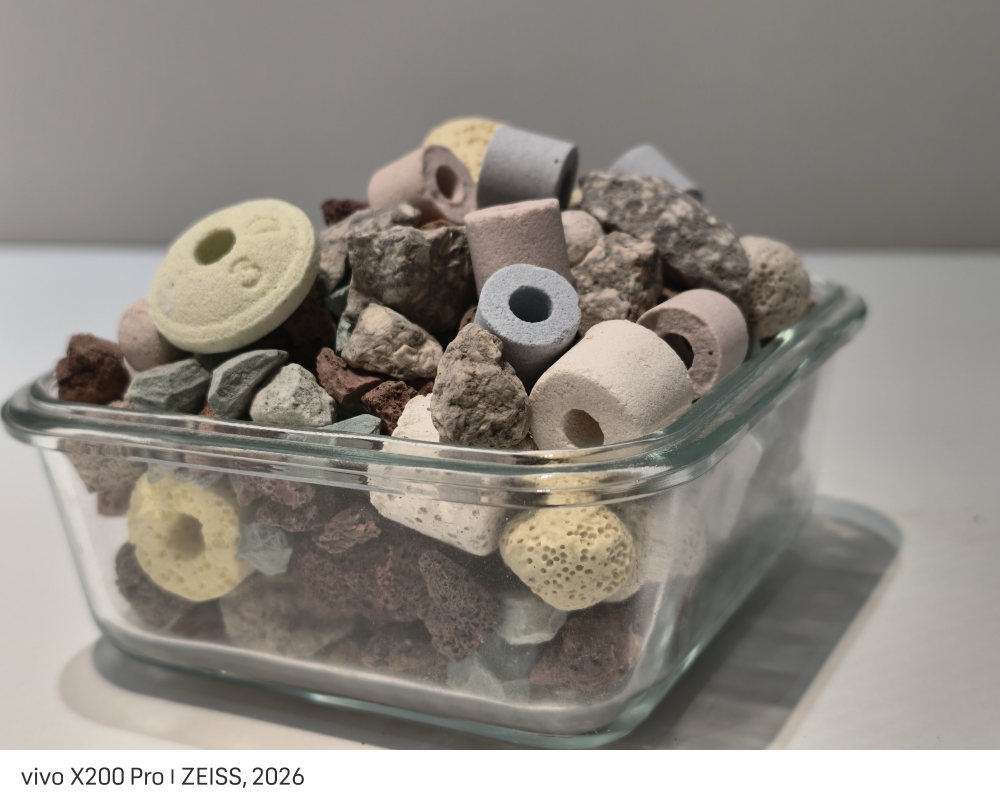
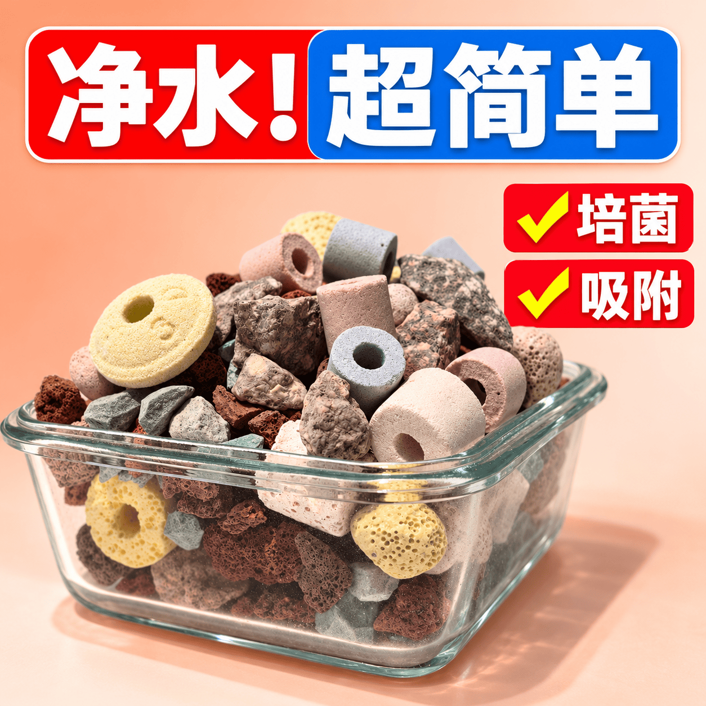

# 拼多多主图换产品 Skill

老链接主图跑了半年、攒了销量和点击权重，新品上市想直接复用，却得整张重做？

这个 Skill 把**新产品实拍**换进**待修改的原主图**里：产品全部换成新的，标题位置、色块、配色、版式、比例原样保留，由图片模型一次直出完整成品——不叠字、不拼图、不拉伸字体。

适用于拼多多，同样适用于淘宝、京东、抖音等需要"沿用老图版式换新品"的场景。

---

## 你可能正卡在这里

- 老图有销量基础，重做一张等于从零开始试错
- 手动换产品：P 歪、光影不对，为了塞进新品把文字重排，原图那点辨识度全丢了
- 丢给 AI 改，产品被重新发明：规格、数量、颜色、孔洞全对不上，还凭空多出几颗
- 后期叠字拼色块：字发虚、圆角糊，256px 缩略图一眼露馅
- 弱模型改两次就崩，不知道该继续重试还是放弃
- 旧图的规格、功效、寿命、赠品被 AI 顺手当成了新品的承诺

## 怎么做的

严格的双参考工作流：

| 参考 | 角色 | 说明 |
|---|---|---|
| **图1** | 新产品原始实拍 | **唯一产品来源**。选主体完整、最接近原构图角度的一张 |
| **图2** | 待修改原主图 | 只供版式、文字、色彩参考。**旧产品不作新产品依据** |

产品、精修、背景、文案、色块、版式由图片模型**同一次输出**完成。

### 两种模式，每次任务先确认

- **A / product-only**：只改产品，原文逐字保留（含规格、数字、标点、徽章、赠品文字）。不自行改标题或"优化文案"。
- **B / product-and-copy**：产品和文字一起改。先列「原文 → 新文」对照；新文未确认前不出正式图。

### 核心原则

- **禁止后期合成**：不叠字、不拼色块、不拉伸字体、不矢量替字、不锐化旧字、不拼接产品
- **锚点逐张登记**：如「左上灰环、上方黄环、中部并排灰柱、矮方玻璃盒」，改完逐张核对有无旧产品残留
- **先一张确认再批量**：样图过了再扩展，不一次性批量返工
- **单张最多 3 次尝试**：首轮 + 2 次定向重试，均从原始参考重做；仍失败就停下报告，不用糊图凑数
- **缩略图验收**：256px 下仍能识别产品和主标题才算过
- **不得用上一张生成图当下一张参考**：每次生成都引用原始实拍

## 两条容易被忽略的边界

这两条是 Skill 里最硬的部分，也是它和"随便丢给 AI 改图"的区别：

1. **旧图的卖点不是新品的事实**
   旧图的规格、功效、寿命、赠品不能推断为新产品属性。发现冲突或未证实信息，单独标记待核对，不自行新增承诺。用户明确要求原文出样可以保留，但会记录「原文沿用，事实未核验」。

2. **容器冲突不给假方案**
   原图高方盒 vs 实拍矮方盒时，只在两个选项里二选一：
   - **产品一致优先**：保留整组实拍，保留原图的标题、色块、配色与层级
   - **构图轮廓优先**：补拍对应容器与角度后再替换

   不把新品硬塞进虚构的旧盒型，也不拆散重排到不存在的高盒里。

另外，图片模型可能重建微孔或反光，Skill 不会宣称"逐像素一致"。

## 确认案例

2026-10-15 滤材主图修改，14 张原主图全套替换。

### A：黑底红黄

| 原主图 | 新产品实拍 | 模型直出（已确认） |
|---|---|---|
|  |  |  |

- 原图：高方透明滤盒、进出水流、红黄标题和底栏
- 实拍：矮方玻璃盒中整组混合滤材
- 关键取舍：用户先要求轮廓接近原图，随后确认**产品一致优先**，因此不把颗粒重排进高方盒
- 文案：好滤材 / 不浑水 / 多合一 / 净水·培菌 / 精选

可复用短提示词见 [`references/confirmed-case.md`](references/confirmed-case.md)。

### B：蜜桃红蓝

| 原主图 | 新产品实拍 | 模型直出（已确认） |
|---|---|---|
|  |  |  |

保留蜜桃背景、红蓝大标题与右侧黄勾红标签，产品用完整实拍矮方盒。

> 案例只用于理解流程与决策，案例文案不是其他商品的事实或默认文案。

## 安装

把整个目录放进你的 Agent 技能目录即可。

```bash
git clone https://github.com/elangan1997-cmyk/pdd-main-image-edit.git \
  ~/.workbuddy/skills/pdd-main-image-edit
```

其他 Agent 的技能目录：Claude Code `~/.claude/skills/`、Codex `~/.codex/skills/`、Cursor `~/.cursor/skills/`。

本 Skill 不依赖其他技能或私有接口，也不要求特定付费 API——用当前环境实际可用的图片生成工具即可。没有图生图能力时会直接报告缺口，不假装调用。

## 附带脚本

脚本只做辅助，**不产出成品图**：

```bash
# 校验模式与映射，生成每张短提示词与参考顺序
python3 scripts/build_batch.py --plan plan.json --output work

# 生成标注角色的输入参考包（单参考模型用）
python3 scripts/prepare_reference.py \
  --product product.jpg --template original.jpg --output work/reference-packet.jpg

# 缺图、尺寸检查与实拍/输出对照（需 Pillow）
python3 scripts/review_batch.py --plan plan.json --results results --output review
```

- 计划格式：[`references/plan-example.json`](references/plan-example.json)
- 弱模型提示词与能力边界：[`references/prompt-and-capabilities.md`](references/prompt-and-capabilities.md)
- 验收清单与失败案例：[`references/qa-and-failure-cases.md`](references/qa-and-failure-cases.md)
- 跨 Agent 接入：[`references/agent-portability.md`](references/agent-portability.md)

## 输出

输出到项目内新目录，不覆盖原片：成品、映射表、实际提示词、逐图 QA、总览与下载包。仅合格图进正式包，预览、待核对项与未完成数量会明示。

## 上架

本 Skill 已上架 SkillHub 商店：`拼多多主图换产品`（slug `pdd-main-image-edit`）。

商店包因平台文件类型白名单不含位图，省略了 `examples/` 目录；完整示例见本仓库。

## License

[MIT](LICENSE) © 2026 elangan1997-cmyk
